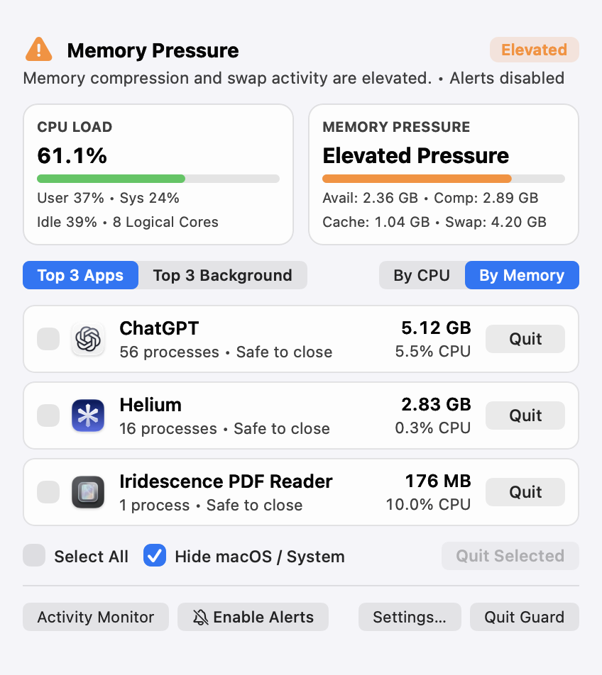
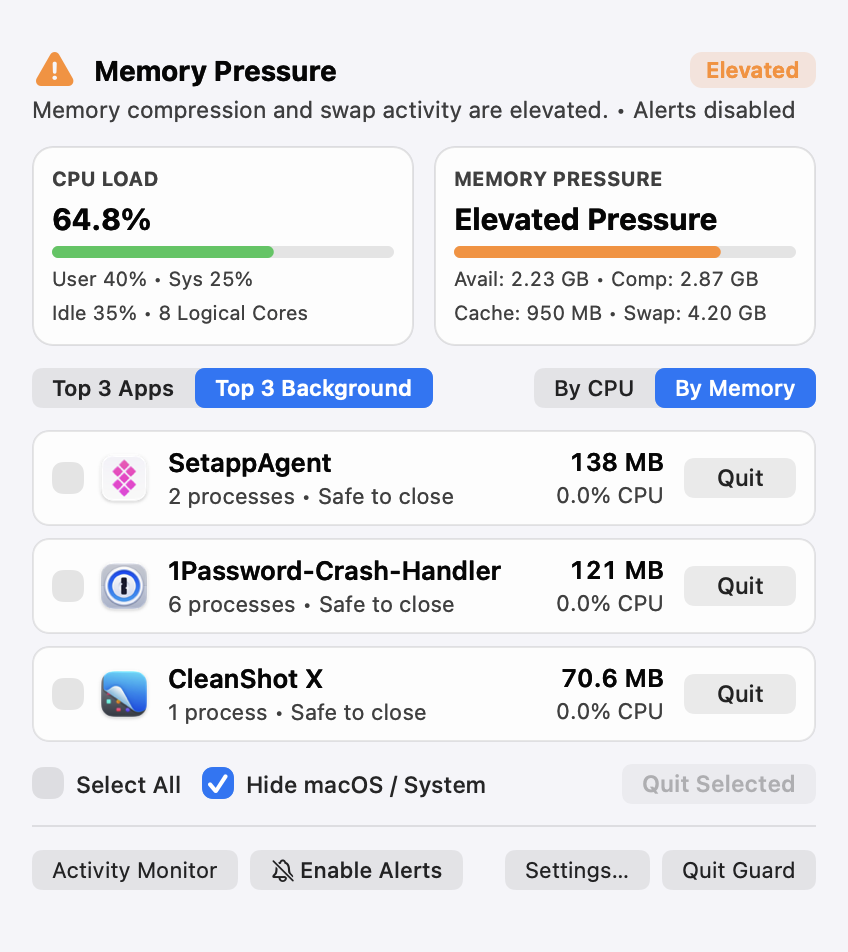

# Resource Guard (Mac Resource Guard)

<p align="center">
  
</p>

<p align="center">
  <b>An ultra-lightweight, native macOS menu bar resource monitor engineered with Swift, AppKit, and Mach/Darwin kernel APIs.</b><br>
  Zero Electron. Zero web views. Intelligent memory-pressure heuristics. Safe process termination.
</p>

<p align="center">
  <a href="https://github.com/gobelet69/mac-resource-guard/releases/latest"></a>
  
  
  
  
  
  
</p>

---

## 1. Overview

**Resource Guard** (`MacResourceGuard`) is an ultra-lightweight menu bar utility created for macOS Apple Silicon users who want transparent, accurate insight into system load without adding overhead. Traditional resource monitors frequently run heavy background polling, shell out to tools like `top` or `ps`, and trigger false memory alerts when macOS uses free RAM for legitimate file caching.

Resource Guard is engineered directly against Apple's **Mach/Darwin kernel subsystem** (`mach/host_info.h`, `mach/vm_statistics.h`, `libproc.h`), consuming virtually unmeasurable CPU (<0.05%) and less than 15 MB of RSS memory while in the background.

---

## 2. Genuine Application Screenshots

| Interactive Popover (Active Applications) | Adaptive Background Idle Mode |
|:---:|:---:|
|  |  |

---

## 3. Main Features

- **Adaptive Two-Tier Kernel Monitoring**:
  - *Idle Tier (Default: 10s)*: Executes only two Mach traps (`host_statistics(HOST_CPU_LOAD_INFO)` and `host_statistics64(HOST_VM_INFO64)`) and two `sysctlbyname` calls (`vm.swapusage`, `kern.memorystatus_vm_pressure_level`) on a background queue. Zero process enumeration and zero subprocess spawning.
  - *Threshold Confirmation Tier (2s)*: Engaged only if sustained CPU load exceeds 85% or kernel memory pressure elevates. Samples delta usage, identifies top culprit applications, and returns immediately to idle monitoring afterward.
- **Intelligent Memory-Pressure Analysis**:
  - Distinguishes reclaimable file cache from true memory exhaustion. Combines kernel dispatch sources (`DispatchSource.makeMemoryPressureSource`) with Mach VM compressor page counts and swapout rates to avoid false alarms when RAM is safely utilized for caching.
- **Helper Process Grouping (Zero Double-Counting)**:
  - Intelligently groups multi-process architectures (such as Google Chrome, Safari, Visual Studio Code, and Discord) by parent PID (`ppid`) and application bundle containment. Memory footprints (`ri_phys_footprint`) and CPU cycles are accurately aggregated without duplicate counting.
- **Safe Application Termination & PID-Reuse Guard**:
  - Prioritizes graceful termination via `NSRunningApplication.terminate()` so applications can present standard macOS unsaved document sheets.
  - Blocks termination of critical system processes (`Finder`, `Dock`, `WindowServer`, `loginwindow`, `SystemUIServer`, `ControlCenter`).
  - Verifies process identity and start timestamp (`PROC_PIDTBSDINFO`) immediately prior to termination to eliminate PID-reuse race conditions.
- **Pure Native AppKit Architecture**:
  - Implemented with `NSStatusBar`, `NSStatusItem`, `NSPopover`, and `NSVisualEffectView`. No SwiftUI attribute-graph churn, no Electron runtime, and zero external dependencies.

---

## 4. System Requirements

- **Operating System**: macOS 14.0 (Sonoma) or newer (macOS 14 and macOS 15+ supported).
- **Architecture**: Apple Silicon (`arm64`, M1/M2/M3/M4) native.
- **RAM**: ~15 MB baseline memory.
- **Permissions**: Standard user permissions. No administrator privileges, root access, kernel extensions, or accessibility permissions are required.
- **Sandboxing**: Runs as a standard macOS user-space application (non-sandboxed) with `<key>com.apple.security.app-sandbox</key><false/>`. Inspecting Darwin Mach kernel host statistics (`host_statistics64`, `host_processor_info`) and system-wide process memory telemetry requires operating outside the container sandbox.

---

## 5. Installation Instructions

1. Download the latest release `.dmg` from the **[GitHub Releases](https://github.com/gobelet69/mac-resource-guard/releases/latest)** page:
   - `MacResourceGuard-1.0.0.dmg`
2. Open the downloaded disk image.
3. Drag **MacResourceGuard.app** into your `/Applications` directory.
4. Launch **MacResourceGuard** from Spotlight or `/Applications`. A discreet telemetry indicator will appear in your macOS menu bar.
5. **macOS Gatekeeper Verification (Non-Notarised Builds)**:
   Because releases are ad-hoc signed without an Apple Developer ID subscription, macOS Gatekeeper may present a dialog on first launch (*"MacResourceGuard cannot be opened because Apple cannot check it for malicious software"*). To safely open the application:
   - **Via Finder**: Right-click (or Control-click) **MacResourceGuard.app** in `/Applications`, choose **Open**, and click **Open** in the confirmation alert. Alternatively, navigate to **System Settings → Privacy & Security** and click **Open Anyway**.
   - **Via Terminal** (optional): Clear the quarantine extended attribute:
     ```bash
     xattr -d com.apple.quarantine "/Applications/MacResourceGuard.app"
     ```
   Once opened, macOS permanently remembers your choice, and subsequent launches start instantly without warnings.

---

## 6. Getting Started

1. **Menu Bar Status Item**: Upon launch, Resource Guard sits discreetly in the top-right menu bar, displaying real-time CPU percentage and memory state.
2. **Open the Telemetry Popover**: Click the menu bar icon to reveal the translucent Liquid Glass popover showing system-wide CPU load, memory distribution, swap space usage, and top resource-consuming applications.
3. **Inspect Applications**: The popover displays aggregated memory footprints and CPU shares for each running app, grouping background helper workers beneath their parent app.
4. **Close the Popover**: Click anywhere outside or press `Esc`. The app immediately ceases high-frequency UI updates and returns to silent 10-second idle background sampling.

---

## 7. Usage Instructions

### Understanding Memory Metrics
- **App Memory**: Active physical memory allocated and held by running applications.
- **Wired Memory**: Memory locked by the macOS kernel that cannot be paged out.
- **Compressed**: Inactive memory compressed in RAM by the macOS virtual memory compressor before swap is engaged.
- **File Cache**: Reclaimable memory holding recently accessed files. macOS intentionally maximizes file cache to make your Mac fast; Resource Guard does not treat this as memory pressure.

### Safely Closing Resource-Heavy Apps
If an application is consuming excessive CPU or memory:
1. Click the application row in the Resource Guard popover.
2. Click **Quit Application**.
3. Resource Guard requests a graceful quit through macOS. If the application has unsaved files, it will prompt you to save.
4. System-critical processes (Finder, Dock, WindowServer) have termination disabled to prevent accidental desktop freezes.

---

## 8. Keyboard Shortcuts

| Shortcut | Action |
|:---|:---|
| `Esc` | Dismiss Telemetry Popover |
| `Up` / `Down` Arrow | Navigate Application List in Popover |
| `Space` / `Return` | Inspect Selected Application Details |
| `Cmd + Q` (while menu active) | Quit Resource Guard |

---

## 9. Building from Source

### Prerequisites
- macOS 14.0 or newer.
- Xcode 15 or 16 with Command Line Tools (`xcode-select --install`).
- [XcodeGen](https://github.com/yonaskolb/XcodeGen) (`brew install xcodegen`).

### Build Steps

1. Clone the repository:
   ```bash
   git clone https://github.com/gobelet69/mac-resource-guard.git
   cd mac-resource-guard
   ```
2. Generate the Xcode project and build Release package:
   ```bash
   ./Scripts/package_dmg.sh
   ```
   The generated `.dmg` package will be created in `dist/MacResourceGuard-1.0.0.dmg`.

> [!TIP]
> If building inside an iCloud-synced folder, run test suites with `--scratch-path /tmp/macresourceguard-build` to ensure macOS FileProvider attributes do not interfere with codesigning.

### Running Automated Tests

Run the complete unit test suite:
```bash
swift test --scratch-path /tmp/macresourceguard-build
```
All 13 test suites verify kernel metric samplers, multi-process aggregators, memory pressure heuristics, and PID-reuse safety.

---

## 10. Troubleshooting

- **Menu bar icon does not appear**:
  On MacBooks with a camera notch, menu bar items can sometimes be hidden by macOS if too many items are active. Hold `Cmd` and drag the Resource Guard icon to reorder it toward the right.
- **CPU percentage differs from Activity Monitor**:
  Resource Guard normalizes total machine capacity to 100% across all cores (e.g., 50% means half the machine's entire computing capacity is utilized), whereas Activity Monitor scales per thread (where an 8-core CPU can reach 800%). Both representations are mathematically accurate.
- **Process memory differs from top**:
  Resource Guard queries `ri_phys_footprint` from `libproc`, which is Apple's recommended metric for physical memory attribution that accounts for dirty pages, shared libraries, and purgeable memory.

---

## 11. Known Limitations

- **Apple Silicon Optimized**: Specifically engineered and tuned for Apple Silicon architecture (`arm64`).
- **Standard User Execution (Non-Sandboxed)**: Operates without root or kernel extensions; root-only daemon internal heaps cannot be inspected beyond standard Mach statistics. App Sandbox is disabled (`com.apple.security.app-sandbox = false`) to permit Mach host telemetry queries.

---

## 12. Download and Releases

Official releases, DMG packages, and checksums are published on GitHub:
- **Latest Release**: [GitHub Releases](https://github.com/gobelet69/mac-resource-guard/releases)
- **Official Showcase**: [111iridescence.org/apps/resource-guard](https://111iridescence.org/apps/resource-guard)

Each release includes an official `.dmg` and cryptographic `SHA256SUMS.txt`.

---

## 13. Contributing

Contributions and bug reports are welcome. Please read [CONTRIBUTING.md](CONTRIBUTING.md) and [SECURITY.md](SECURITY.md) before submitting pull requests. Ensure all tests pass (`swift test --scratch-path /tmp/macresourceguard-build`) and that no high-frequency polling is introduced into the idle tier.

---

## 14. Licence

This project is licensed under the **[MIT Licence](LICENSE)**.

---

## 15. Acknowledgements

- Built with native Apple AppKit and low-level Darwin / Mach kernel interfaces.
- Designed and benchmarked specifically for Apple Silicon macOS power users.
- Developed by **[111iridescence](https://111iridescence.org)** with AI-assisted software systems engineering.
